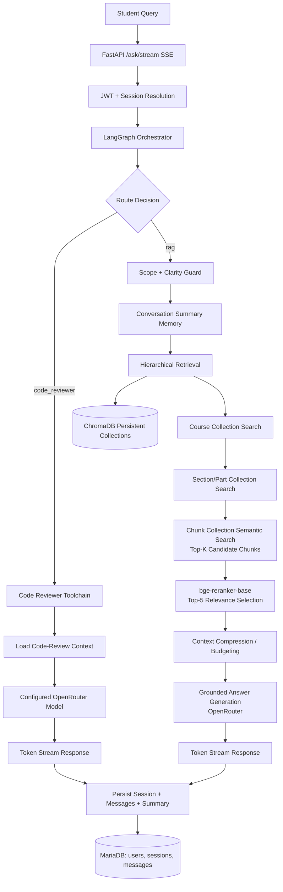

# AI LilMose3da
### OpenRouter-Powered Agentic RAG Tutor for Data Science: LangGraph-Orchestrated, Retrieval-First, with Local Embeddings and Reranking

## 1. Project Title & Catchy Subtitle

**AI LilMose3da** is a local-first AI learning assistant engineered for Data Science education.
It combines a retrieval-augmented generation (RAG) pipeline with tool-based orchestration to route user intent between:

- High-precision course question answering
- Code explanation and debugging support

Chat generation uses OpenRouter; embeddings and reranking run locally to keep retrieval independent of the hosted LLM.

## 2. Overview & Impact

AI LilMose3da was built as a production-style academic assistant that can handle both conceptual learning and practical coding support in a single conversational system. The backend uses FastAPI for streaming inference, LangGraph for deterministic tool routing, ChromaDB for semantic retrieval, and a MariaDB-backed session layer for persistent conversational state.

The retrieval subsystem is intentionally multi-stage and hierarchical:

- Coarse course-level narrowing
- Section-level narrowing
- Dense chunk-level semantic retrieval
- Lightweight BM25 ranking over chunk text
- Reciprocal Rank Fusion (RRF) to merge semantic and BM25 signals
- Cross-encoder reranking with bge-reranker-base
- Context compression before final generation

This architecture improved student checkpoint outcomes from a baseline around **60%** to a consistent **87-92%** after deployment in local learning workflows.

> **Measured Outcome:** Structured AI-assisted study sessions powered by grounded retrieval increased checkpoint performance from **60%** to **87-92%**.

## 3. Architecture

### System Flow

The platform is built around a LangGraph router node that dispatches each query to a specialized execution path:

- **RAG path** for grounded course-content QA
- **Code reviewer path** for code explanation, debugging, and follow-up code edits

For RAG, the system performs hierarchical retrieval over three Chroma collections (`course`, `part`, `chunk`), gathers top semantic candidates (top-25 design target), adds a lightweight internal BM25 ranking step, fuses semantic and BM25 rankings via RRF, reranks to top-5 with `bge-reranker-base`, compresses context when needed, and then prompts the configured OpenRouter model for final grounded response generation.

FastAPI streams token outputs over SSE, while user accounts, sessions, titles, message history, and memory summaries are persisted through the backend session management layer backed by MariaDB.



### Data and Control Planes

- **Control plane:** LangGraph state machine handles deterministic routing and node transitions.
- **Retrieval plane:** ChromaDB semantic search + cross-encoder reranking.
- **Generation plane:** OpenRouter by default (or Ollama when explicitly selected), constrained by retrieved context and guardrails.
- **Persistence plane:** MariaDB stores user/session/message continuity and session-level memory summaries.

## 4. Key Features

- **Agentic Orchestration with LangGraph:** Query-level dynamic routing between RAG and code-review execution paths.
- **Hierarchical Semantic Retrieval:** Course -> section -> chunk narrowing to reduce retrieval noise and improve grounding quality.
- **Multi-Stage RAG Pipeline:** Candidate retrieval + cross-encoder reranking + context compression before generation.
- **Grounded Response Policy:** Generation is explicitly constrained to retrieved context with out-of-scope and ambiguity safeguards.
- **Persistent Conversational Memory:** Summary-based memory supports follow-up continuity across sessions.
- **Structured Session Infrastructure:** User auth, session lifecycle, title management, and message history persisted in backend storage.
- **Real-Time Streaming UX:** SSE token streaming from FastAPI for responsive chat interactions.
- **Flexible Model Providers:** Use OpenRouter by default or select local Ollama with `LLM_PROVIDER=ollama`.
- **Code Assistance Path:** Dedicated tooling for explaining, debugging, and iterating over code-centric student prompts.

## 5. Tech Stack

| Category | Technologies |
|---|---|
| **LLMs** | OpenRouter model (default) via the OpenAI-compatible LangChain client, or local Ollama |
| **Embedding Models** | `nomic-embed-text` via Ollama Embeddings API |
| **Reranking** | `BAAI/bge-reranker-base` (Sentence Transformers CrossEncoder) |
| **Orchestration** | LangGraph, LangChain Core |
| **RAG Retrieval** | ChromaDB (`PersistentClient`) with hierarchical collections (`courses`, `parts`, `chunks`) |
| **Backend API** | FastAPI, Pydantic, SSE streaming (`StreamingResponse`) |
| **Session/Data Persistence** | MariaDB-compatible relational schema accessed with PyMySQL |
| **Authentication** | JWT (`python-jose`), secure HTTP-only cookies |
| **Frontend** | React + Vite, Axios, Markdown/KaTeX rendering |
| **Infrastructure** | Dockerized local deployment, local model serving with Ollama |

---

This project is designed to showcase production-minded AI engineering: retrieval-grounded generation, explicit orchestration, memory-aware dialogue, and end-to-end persistence under a local-first deployment model.

## Testing

The default test suite uses deterministic in-memory vector collections and mocked model/API boundaries. It does not connect to MariaDB, call Ollama, download models, or read the persisted production vector database.
GitHub Actions runs this suite on Windows for pushes and pull requests targeting `main`; no live database is required.

## Quiz and flashcard endpoints

Authenticated students can generate course-grounded study material using the same Chroma retrieval and reranking pipeline as chat:

- `POST /quizz/` accepts `{"subject":"decision trees","number_quizzes":3,"number_options":4}`.
- `POST /flashcard/` accepts `{"topic":"decision trees","number_flashcards":7}`.

Both responses include a `sources` list with course, section, source file, and chunk ID metadata. The generated questions/cards are limited to retrieved course content; requests without matching context return `422`, and invalid model output returns `502`. These endpoints use the existing authentication cookie and do not persist generated material.

OpenRouter is the default chat provider. Set `OPENROUTER_API_KEY` to your OpenRouter API key in the root `.env` file, and optionally set `OPENROUTER_MODEL` (default: `openai/gpt-4o-mini`). You can explicitly select local chat generation with `LLM_PROVIDER=ollama`. Ollama is still used for local embeddings in either configuration.

Activate the project environment from the repository root before installing test tools or running Python:

```powershell
conda activate agents_env
```

Install the test dependencies when setting up the environment:

```powershell
python -m pip install -r requirements-test.txt
```

Run the complete suite or one category:

```powershell
pytest
pytest -m unit
pytest -m integration
pytest -m feature
pytest -m e2e
```

Generate a coverage report for the retrieval, document-processing, orchestration, API, and auth modules:

```powershell
pytest --cov=backend.rag.retriever --cov=backend.rag.pdf_processor --cov=backend.rag.notebook_processor --cov=backend.rag.orchestrator --cov=backend.helper --cov=backend.main --cov-report=term-missing --cov-report=html
```

The optional HTML report is written to `htmlcov/`. Real-model and live-database tests are intentionally not part of the default suite; add explicit infrastructure configuration before running those checks.

## Retrieval experiments

The golden retrieval set at `data/processed/retrieval_golden_dataset.json` labels relevant sources by `course`, `section`, and `source_file`, so evaluation labels remain valid when the corpus is re-chunked. Section comparison ignores whitespace and case to tolerate OCR inconsistencies. The runner compares chunk size/overlap, top-k, and Chroma HNSW distance/index settings, then logs hit rate, source recall, MRR, dense/rerank/total query latency, index build time, and embedding time to MLflow. Chunk lengths follow the existing whitespace-based token-like counter. The default methods are `dense` (vector only), `hybrid` (vector + BM25 with RRF), and `hybrid_rerank` (the same hybrid candidate set reranked using the project’s `BAAI/bge-reranker-base` CrossEncoder). Each child run also logs per-query gold labels and retrieved sources as `evaluation/retrieval_results.json`.

Run the default sweep from the repository root in `agents_env` with Ollama serving `nomic-embed-text`:

```powershell
conda run -n agents_env --no-capture-output python -m scripts.run_retrieval_experiments
```

By default, the sweep uses chunk sizes `300,500,700`, overlaps `50,100`, top-k values `5,10,20`, a candidate pool of 20, cosine/L2/inner-product spaces, and HNSW search ef values `50,100`. The reranker is loaded from the local Hugging Face cache (`local_files_only=True`); no model is downloaded by the runner. To smoke-test a small selection, pass explicit values and `--limit-queries 2`. The runner creates temporary in-memory indexes and does not change `backend/vectordb/chroma_db`. MLflow writes the experiment and runs to the repository-root SQLite database `mlflow.db`.

**Important:** this repository may contain an older `mlruns/` directory. MLflow can select that file store when the UI starts without an explicit backend URI, which makes the SQLite experiment appear empty. From the repository root, always point the UI at the same SQLite database used by the runner:

```powershell
mlflow ui --backend-store-uri sqlite:///./mlflow.db
```

In the UI, select the `rag-retrieval-tuning` experiment. The sweep has one parent run and one child run per configuration; select a child run to inspect its chunk/index/top-k parameters and retrieval/latency metrics. The golden dataset is logged as a parent-run artifact under `evaluation/`.

See the [retrieval experiment report](./reports/retrieval-experiment-report.md) for the recorded tuning and reranker-ablation findings, including per-query ranking changes and evaluation caveats.

## 6. Docker Deployment

You can run the full stack (frontend + backend + MariaDB + Ollama for embeddings) with Docker Compose. Chat generation requires an OpenRouter API key in `.env`.

### Configure secrets

Create a local env file from the template and set your real values:

```bash
cp .env.example .env
```

The `.env` file is ignored by git, so secrets stay out of source control.

### Start services

```bash
docker compose up --build -d
```

### Pull the Ollama embedding model (first run only)

```bash
docker compose exec ollama ollama pull nomic-embed-text
```

### Access apps

- Frontend: http://localhost:5173
- Backend API health: http://localhost:8000/health
- Ollama API: http://localhost:11434

### Stop services

```bash
docker compose down
```

### Troubleshooting authentication

Registration requires a username of at least 2 characters, a valid email, and a password of at least 8 characters.

If login returns a database access-denied error for `ai_user`, set `DB_PASSWORD` in the root `.env` to the password configured for that database account. With Docker Compose, MariaDB only creates the account from these environment values when its data volume is first initialized; changing `.env` later does not update the stored account password. Update the MariaDB account password to match `.env` or restore the original value, then restart the backend. Do not remove the database volume unless you intend to erase its data.

## User document ingestion

The standalone ingestion script accepts one PDF or Jupyter notebook for an existing user. It stores document metadata in MariaDB (`documents` and `user_documents`) and chunks/embeddings in the separate `user_document_chunks` Chroma collection. It does not modify the global course collections or copy the original file; the source remains at its current path until file storage is added.

Apply the document tables from `docker/db/init.sql` to an existing database if it was initialized before these tables were added. With MariaDB on port `3306`, the database and Ollama settings configured, and the `nomic-embed-text` model available, run this from the repository root in `agents_env`:

```powershell
conda activate agents_env
python -m scripts.ingest_user_document --file "C:\path\to\document.pdf" --user-id "<existing users.id>"
```

To verify MariaDB persistence with a real database connection (without calling Ollama), start MariaDB, configure `DB_HOST`, `DB_PORT`, `DB_USER`, `DB_PASSWORD`, and `DB_NAME`, and apply the document tables first. Then run:

```powershell
conda activate agents_env
$env:RUN_MARIADB_INTEGRATION = "1"
pytest tests/integration/test_user_document_persistence.py -q
```

This opt-in test uses an existing user, ingests a small test document, verifies the committed document-owner relationship from a fresh database connection, and removes the temporary document row. It skips if the database has no users. Without `RUN_MARIADB_INTEGRATION=1`, it is skipped.

The chat sidebar provides a dropzone and file picker for PDF or Jupyter notebook uploads up to 25 MiB. The authenticated FastAPI endpoint `POST /documents/upload` accepts a multipart `file` field, assigns ownership from the authenticated account, and returns the new document ID and processed chunk count. The endpoint stores only the filename and indexed chunks; file-object storage is deferred.
